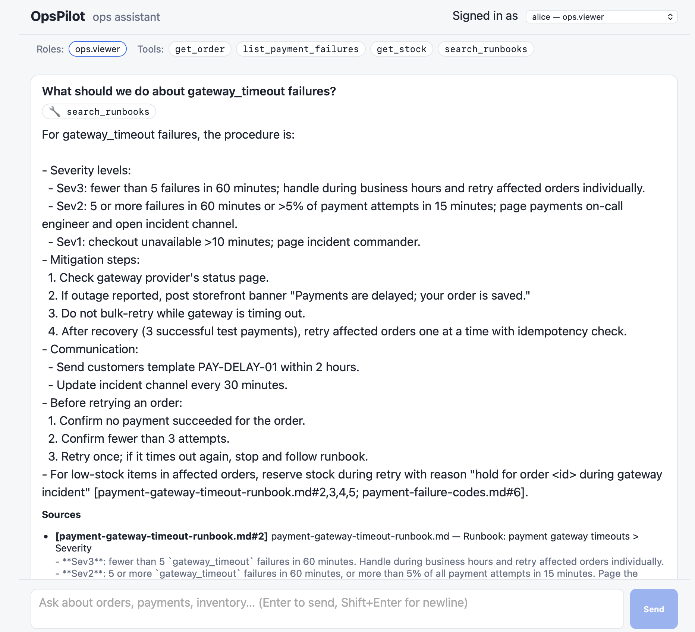

# OpsPilot

A chat assistant for an e-commerce support/ops team. You can ask it things like "why did order 123 fail?" or "are we in an incident right now?" and it answers using our runbooks (RAG over markdown files) plus a few tools that call a small orders/payments/inventory API.

I wanted to try Microsoft.Extensions.AI with tool calling where the tools you get depend on who you are, so a viewer can only look things up and an operator can also retry payments or reserve stock.



## How it works

```
Angular (4200) --SSE--> Orchestrator (5102) --REST + user JWT--> OpsApi (5101)
                              |                                     |
                        Azure OpenAI                        Postgres (opsdb)
                     (chat + embeddings)
                              |
                     Postgres + pgvector (aidb)
```

- **Orchestrator**: the chat endpoint. It searches the runbooks, decides which tools to give the model based on the user's roles, and streams the answer back over SSE (text, tool calls and citations).
- **OpsApi**: fake system of record with orders, payment attempts and stock. Seed data is created on first run. The orchestrator forwards the user's token so the API checks permissions too, not just the model side.
- **web/opspilot-web**: Angular chat UI with a user switcher so you can test the different roles.
- **knowledge/**: the runbooks. They're chunked by heading, embedded and stored in pgvector on startup.

Traces for the chat, tool calls and model requests go to the Aspire dashboard through OpenTelemetry.

## Tools and roles

Everyone with `ops.viewer` gets `search_runbooks`, `get_order`, `list_payment_failures` and `get_stock`.
`ops.operator` and `ops.admin` also get `retry_payment` and `reserve_stock`. A user with no roles (mallory) can't use the chat at all.

Some rules are enforced in the API and not only in the prompt: fraud_suspected orders can't be retried, and a reservation is capped at 50 units.

## Running locally

You need the .NET 10 SDK, Docker, Node 24 (or 22.22+) and an Azure OpenAI resource with two deployments named `chat` and `embeddings`. By default it uses keyless auth, so log in with `az login` first.

```bash
dotnet user-secrets set "AzureOpenAI:Endpoint" "https://<your-resource>.services.ai.azure.com/" --project src/OpsPilot.Orchestrator
make tokens
make dev
```

`make tokens` creates dev JWTs for alice (viewer), bob (operator), carol (admin) and mallory (no roles) and writes them into `web/opspilot-web/src/app/dev-tokens.ts`, which is gitignored.

`make dev` starts Postgres and the Aspire dashboard in Docker, then runs the OpsApi, the orchestrator and the Angular app with all the logs in one terminal. Open http://localhost:4200. The dashboard is at http://localhost:18888.

Other targets: `make infra`, `make stop`, `make down`, `make logs`, `make clean` (this also deletes the db volume).

If you'd rather use an API key, set `AzureOpenAI:ApiKey` in user secrets too. Use the resource root URL for the endpoint, not the Foundry project URL.

## Endpoints

Orchestrator:
- `POST /api/chat`: the chat (SSE)
- `GET /api/me`: roles and tools for the current user
- `GET /api/knowledge/documents`, `GET /api/knowledge/search?q=`
- `POST /api/admin/ingest`: re-embed the runbooks (admin only)

OpsApi:
- `GET /orders/{id}`, `POST /orders/{id}/payments/retry`
- `GET /payments/failures?sinceHours=24`
- `GET /inventory/{sku}`, `POST /inventory/{sku}/reservations`

There are sample requests in `src/OpsPilot.OpsApi/OpsPilot.OpsApi.http`.

## Testing the answers

`eval/golden-questions.md` has 14 questions I run by hand after changing the prompt or the retrieval settings. Each row has which tools it should call and what the answer must or must not say. It includes permission checks, the fraud case, a prompt injection attempt and an off-topic question.

## Notes

- There's no server-side chat storage. The UI sends the conversation with each request and only the last 12 messages are used.
- Search uses a max cosine distance (`Knowledge:MaxDistance`). If nothing is close enough, it says the runbooks don't cover it rather than guessing.
- `Mcp/OpsMcpTools.cs` is empty for now. I'd like to expose the same tools over MCP later.
